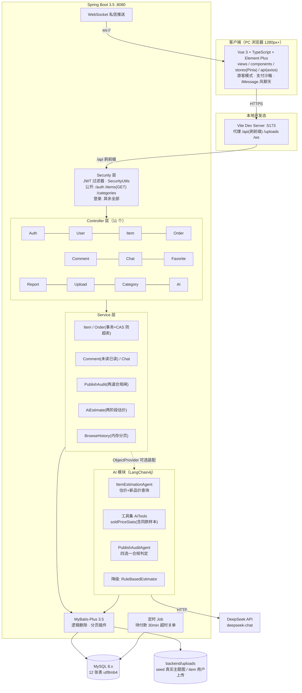
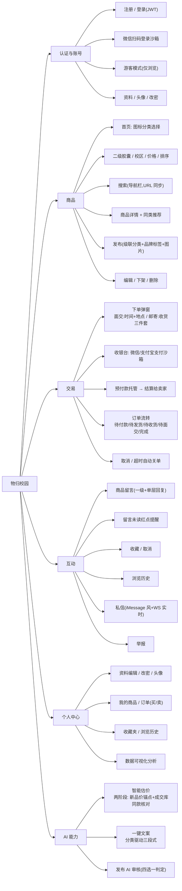
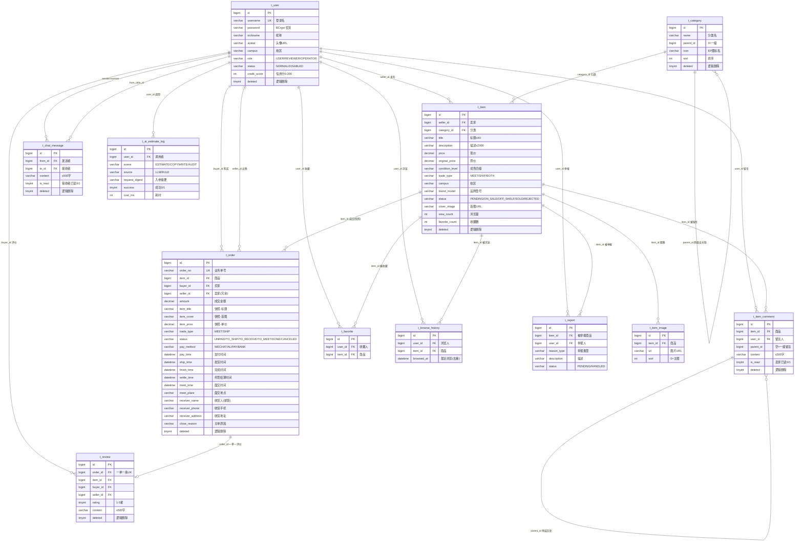
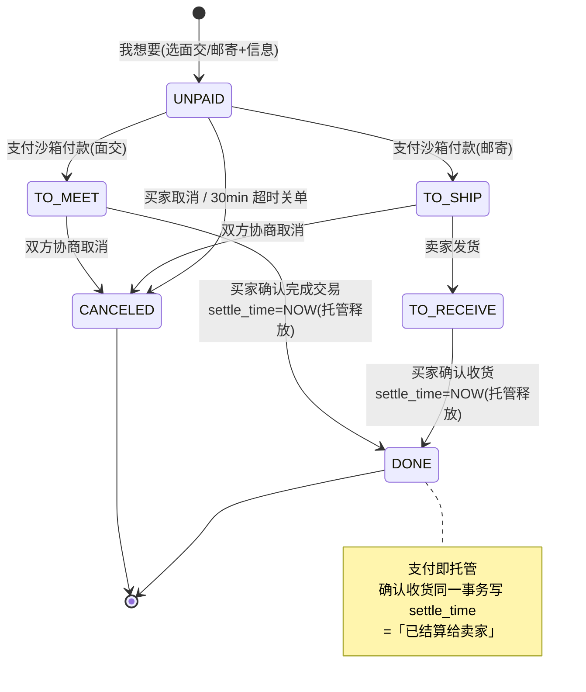
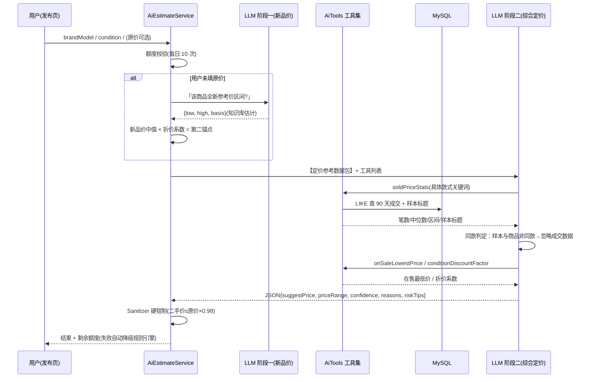

# 系统设计文档（DESIGN）

> 「物归校园」（Brix Campus Market）架构设计图、功能结构图、数据库 E-R 图与核心流程图。
> 配套：[API.md](API.md)（接口文档）· [STARTUP.md](STARTUP.md)（启动指南）· [ARCHITECTURE.md](ARCHITECTURE.md)（架构文字版）

---

## 一、系统架构图

**架构要点**

| 主题 | 决策 |
| --- | --- |
| 响应体 | 统一 `R{code,msg,data,timestamp}`；业务失败 HTTP 仍 200，凭 `code` 判断 |
| 精度 | 全部 `Long` 序列化为字符串（防 JS 精度丢失），前端以字符串比较 |
| 事务 | 三个事务边界：`pay`（抢占商品+关同品其它待付款单）/ `cancel`（回滚在售）/ `confirm`（完成+托管结算） |
| 防超卖 | 条件更新影响行数 CAS（`WHERE status='ON_SALE'`），不用 `FOR UPDATE` |
| AI 装配 | `ObjectProvider` 可选注入，无 Key 时自动降级规则引擎，系统不崩 |
| 精度外的资金 | 预付款托管：`pay` 入托管，`confirm` 同一事务写 `settle_time` 释放 |

---

## 二、功能结构图

---

## 三、数据库 E-R 图

12 张表：`t_user`（用户）、`t_category`（分类，自关联两级）、`t_item`（商品）、
`t_item_image`（图集）、`t_browse_history`（浏览历史）、`t_favorite`（收藏）、
`t_item_comment`（商品留言，单层回复）、`t_order`（订单，含托管结算）、
`t_review`（评价，一单一条）、`t_report`（举报）、`t_chat_message`（私信）、
`t_ai_estimate_log`（AI 调用日志/额度）。

**设计要点**

- 商品与订单解耦：订单冗余 `item_title / item_cover / item_price` 快照，商品改价/删除不影响历史订单展示
- 分类两级自关联（`parent_id=0` 为一级），前端图标卡 → 胶囊两级联动直接消费
- 留言 `parent_id` 只允许一层回复；`is_read` 驱动导航「留言」红点
- `t_browse_history` 按人按商品去重、保留最近浏览时间（内存分页，单用户上限 50 条）
- 软删除统一 `deleted` 字段（MyBatis-Plus `@TableLogic`）

---

## 四、核心流程

### 4.1 订单状态机

### 4.2 两阶段 AI 估价时序

---

## 五、表清单速查

| 表 | 用途 | 关键约束 |
| --- | --- | --- |
| `t_user` | 用户 | `username` 唯一；BCrypt 密文 |
| `t_category` | 两级分类 | `parent_id=0` 一级；图标名须为 EP 真实图标 |
| `t_item` | 商品 | 状态机 `PENDING→ON_SALE→SOLD`；快照外冗余 |
| `t_item_image` | 商品图集 | `sort=0` 主图 |
| `t_item_comment` | 商品留言 | 回复仅一层；`is_read` 驱动红点 |
| `t_order` | 订单 | `order_no` 唯一；快照字段 |
| `t_review` | 评价 | `order_id` 唯一（一单一评） |
| `t_favorite` / `t_browse_history` | 收藏 / 足迹 | 人+商品去重 |
| `t_report` | 举报 | 审核后台处理 |
| `t_chat_message` | 私信 | 双向已读标记 |
| `t_ai_estimate_log` | AI 日志 | 每日额度统计来源 |
